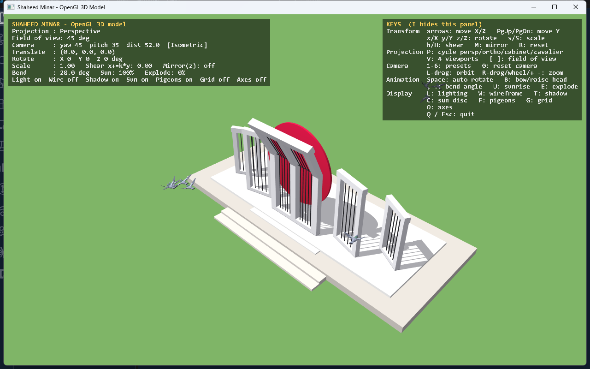
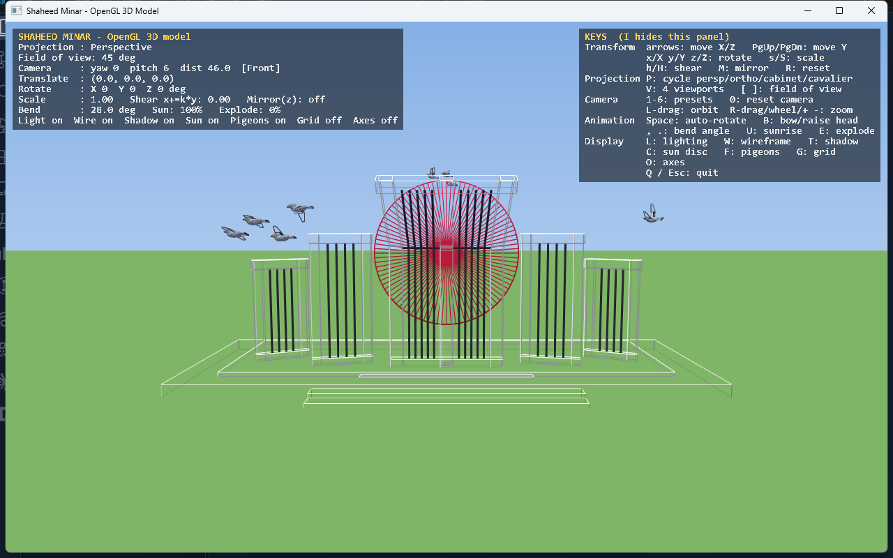
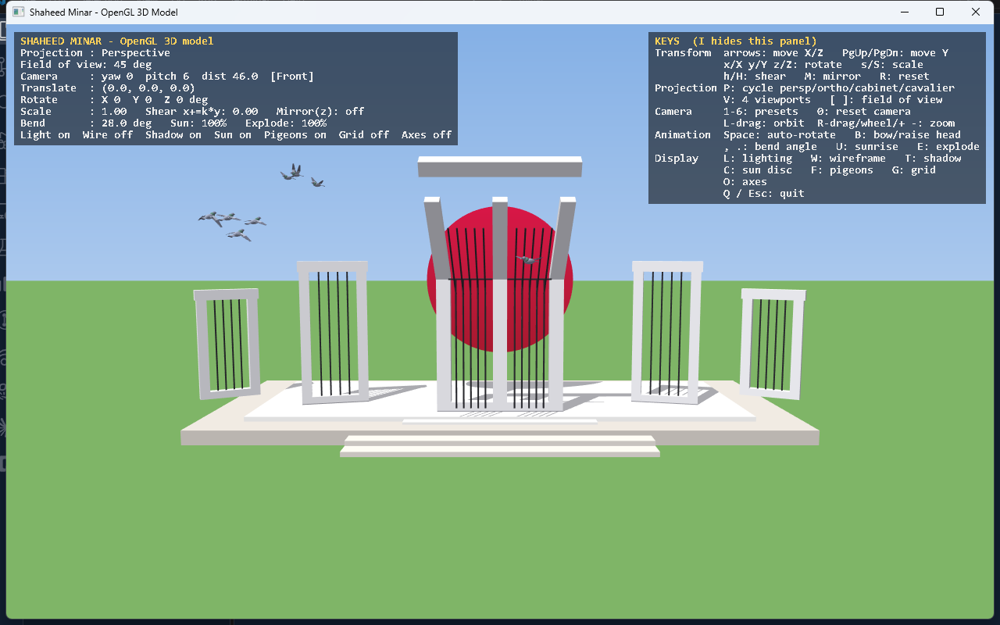
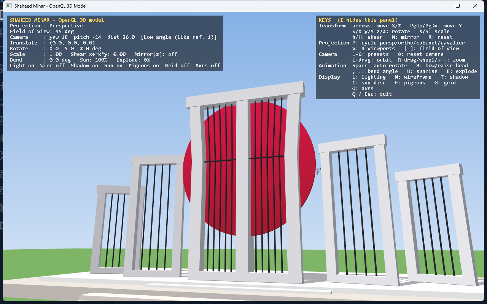
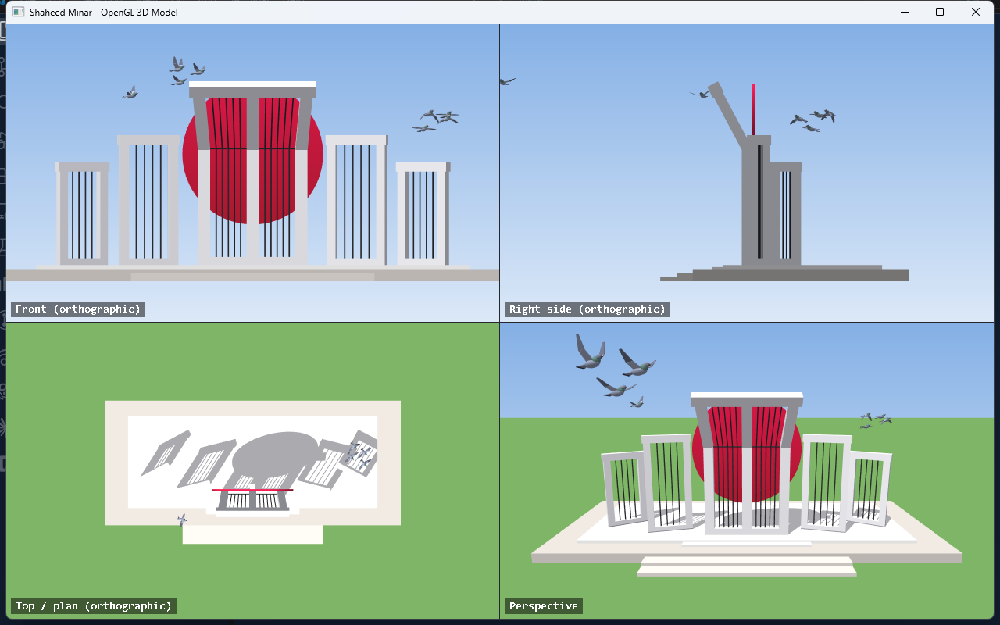
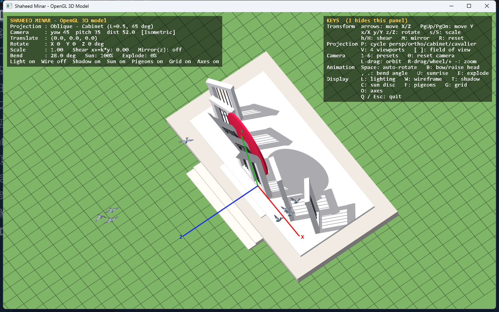

# 🇧🇩 Shaheed Minar — OpenGL 3D Model

An interactive 3D model of the **Central Shaheed Minar** (Dhaka), the monument to the
1952 Language Movement martyrs. It is written in C++ with **fixed-function OpenGL 1.1 + GLU**
and is meant for demonstrating **projection, transformation, hierarchical modelling,
shadows and animation** in a Computer Graphics course.


---

## ✨ Features

- **Accurate five-frame layout** – a central "mother" frame with a bowed head, flanked by four "son" frames on an arc.
- **Iron rods, marble dais, steps and a red sun disc** that can rise like a sunrise.
- **8 animated pigeons** flapping and banking along looping flight paths.
- **Four projections** – perspective, orthographic, oblique cabinet, oblique cavalier.
- **Model transformations** – translate, rotate, scale, shear and mirror from the keyboard.
- **Planar projected shadows** using the stencil buffer.
- **Four-viewport engineering drawing** (front, side, plan + 3D).
- **Exploded view**, wireframe, grid, axes, on-screen HUD and key help.
- **No dependencies** – a pure Win32 front end, *or* a GLUT front end.

## 📸 Gallery

| Isometric view | Wireframe |
|:---:|:---:|
|  |  |
| **Exploded view** (`E`) | **Head raised straight** (`B`) |
|  |  |

**Four viewports** (`V`) – orthographic front, side and plan next to the 3D camera:



**Oblique cabinet projection** with grid, axes and shadows:



### Reference illustrations the model is based on

| Reference 1 | Reference 2 |
|:---:|:---:|
|  |  |

---

## 🚀 Quick start

**Windows, no extra libraries**

```bat
build.bat
shaheed_minar.exe
```

`build.bat` uses the CodeBlocks MinGW compiler if present, otherwise `g++` from `PATH`.

**GLUT / freeglut** (usual course setup)

```bash
g++ -O2 -o shaheed_minar_glut.exe src/main_glut.cpp src/app.cpp src/minar_model.cpp \
    src/geometry.cpp src/pigeons.cpp -lfreeglut -lopengl32 -lglu32
```

On Linux use `-lglut -lGLU -lGL`. More detail: [docs/01-getting-started.md](docs/01-getting-started.md).

## 🎮 Controls (cheat sheet)

| Group | Keys |
|---|---|
| Translate | Arrow keys (X / Z), PgUp / PgDn (Y) |
| Rotate | `x` `X`, `y` `Y`, `z` `Z` (±5°) |
| Scale / shear / mirror | `s` `S`, `h` `H`, `M`, `R` resets |
| Projection | `P` cycle, `V` four viewports, `[` `]` field of view |
| Camera | `1`–`6` presets, `0` reset, left-drag orbit, right-drag / wheel / `+` `-` zoom |
| Animation | Space auto-rotate, `B` bow/raise head, `,` `.` bend angle, `U` sunrise, `E` explode |
| Display | `L` light, `W` wire, `T` shadow, `C` sun, `F` pigeons, `G` grid, `O` axes, `I` help, `Q`/Esc quit |

## 📁 Project layout

```
minar/
├── build.bat            Windows build script (Win32 front end)
├── shaheed_minar.exe    Prebuilt executable
├── ref/                 Reference images used to proportion the model
├── docs/                Full documentation (start at docs/README.md)
└── src/
    ├── main_win32.cpp   Window + GL context + event loop (Win32/WGL)
    ├── main_glut.cpp    Same job using GLUT
    ├── app.h / .cpp     Camera, projections, transforms, shadows, HUD, input, animation
    ├── minar_model.h/.cpp  The monument: platform, frames, rods, sun
    ├── pigeons.h / .cpp   Animated pigeons and their flight paths
    └── geometry.h / .cpp  Primitives: hexahedron, box, rod, ellipsoid
```

## 📚 Documentation

Everything is explained, beginner-friendly, in [`docs/`](docs/README.md):

| Doc | What you will learn |
|---|---|
| [01 Getting started](docs/01-getting-started.md) | Build, run, controls, troubleshooting |
| [02 Architecture](docs/02-architecture.md) | How the files fit together, the frame loop |
| [03 Geometry primitives](docs/03-geometry.md) | `drawHex`, `drawBox`, `drawRod`, ... line by line |
| [04 The monument model](docs/04-monument-model.md) | Every part and constant of the Minar |
| [05 Pigeons](docs/05-pigeons.md) | Hierarchical wings, flight paths, banking |
| [06 App, camera & projections](docs/06-app-camera-projection.md) | Transforms, projections, shadows, HUD, animation |
| [07 Front ends](docs/07-frontends.md) | Win32 vs GLUT, anti-aliasing, event loop |
| [08 Modification guide](docs/08-modification-guide.md) | "If I change X, what happens?" |
| [09 Glossary](docs/09-glossary.md) | Computer graphics terms in plain words |

## 🧠 Where each concept lives

| Concept | Location |
|---|---|
| Composite transform `T·Rx·Ry·Rz·S·Shear·Mirror` | `applyModelTransform()` – `src/app.cpp` |
| Hierarchical modelling (bowed head) | `drawCentralFrame()` – `src/minar_model.cpp` |
| Perspective / orthographic / oblique | `setProjection()` – `src/app.cpp` |
| Planar shadow matrix + stencil | `shadowMatrix()`, `drawShadows()` – `src/app.cpp` |
| Two-joint flapping wing | `drawWing()` – `src/pigeons.cpp` |
| Anti-aliasing | `chooseMultisampleFormat()` – `src/main_win32.cpp` |

## 📝 Notes

Units are metres, **Y is up**, the monument faces **+Z**. Dimensions are approximate,
proportioned from the reference images.
