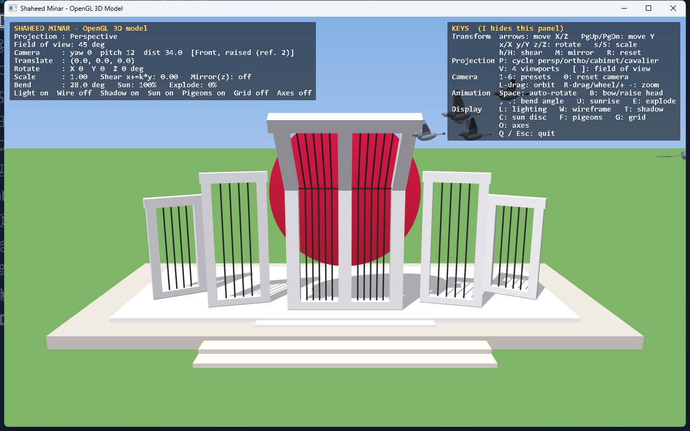

# 1. Getting Started

## Requirements

| Front end | Needs |
|---|---|
| Win32 (default) | Windows, MinGW `g++`. Links only `opengl32`, `glu32`, `gdi32` — all ship with Windows. |
| GLUT | freeglut headers + libs (`-lfreeglut`), or `-lglut -lGLU -lGL` on Linux |

A GPU/driver with OpenGL 1.1 is enough. If the driver offers multisampling, the picture is anti-aliased automatically.

## Building

### Win32 (no extra libraries)

Run `build.bat`. It does the following ([build.bat](../build.bat)):

1. Uses `g++` from `PATH`, unless `C:\Program Files\CodeBlocks\MinGW\bin\g++.exe` exists, in which case that folder is put first on `PATH`.
2. Compiles `main_win32.cpp app.cpp minar_model.cpp geometry.cpp pigeons.cpp` with `-O2 -Wall`.
3. Links `-lopengl32 -lglu32 -lgdi32`, with `-mwindows` (no console window) and `-static` (no MinGW DLLs needed next to the exe).
4. Produces `shaheed_minar.exe`.

### GLUT

```bash
g++ -O2 -o shaheed_minar_glut.exe src/main_glut.cpp src/app.cpp src/minar_model.cpp src/geometry.cpp src/pigeons.cpp -lfreeglut -lopengl32 -lglu32
```

In CodeBlocks, create a GLUT project and add those five `.cpp` files.

> **Rule:** exactly one `main_*.cpp` is compiled. The other four `.cpp` files are common to both front ends.

## Controls in detail

### Model transformation (applies to the whole monument)

| Key | Effect | Range |
|---|---|---|
| ← → | translate X by ∓0.5 | unlimited |
| ↑ ↓ | translate Z by ∓0.5 (up = away) | unlimited |
| PgUp / PgDn | translate Y by ±0.5 | unlimited |
| `x` / `X` | rotate about X by −5° / +5° | unlimited |
| `y` / `Y` | rotate about Y | unlimited |
| `z` / `Z` | rotate about Z | unlimited |
| `s` / `S` | scale ÷1.05 / ×1.05 | 0.2 – 4 |
| `h` / `H` | shear `x += k·y`, k ∓0.05 | −1 – 1 |
| `M` | mirror through the XY plane (z → −z) | toggle |
| `R` | reset all of the above and stop auto-rotate | |

### Projection and camera

| Key | Effect |
|---|---|
| `P` | cycle perspective → orthographic → cabinet → cavalier |
| `V` | toggle four-viewport layout |
| `[` `]` | field of view −/+5° (15–100) |
| `1`…`6` | camera presets: Front, Right side, Top, Isometric, Low angle (ref. 1), Front raised (ref. 2) |
| `0` | reset camera to preset 6 and FOV 45° |
| left-drag | orbit (yaw / pitch) |
| right-drag, wheel, `+`/`-` | zoom (distance 5–200) |

### Animation

| Key | Effect |
|---|---|
| Space | auto-rotate model about Y at 25°/s |
| `B` | head bows forward ↔ stands straight |
| `,` `.` | bend target −2° / +2° (range −30 … 45) |
| `U` | replay the sunrise |
| `E` | exploded view on/off |

### Display toggles

`L` lighting · `W` wireframe · `T` shadow · `C` sun disc · `F` pigeons · `G` ground grid · `O` axes · `I` help panel · `Q`/Esc quit.

## What you should see



* **Top-left panel:** live values (projection, camera, transform, bend, toggles).
* **Top-right panel:** key help (hide with `I`).
* In four-viewport mode (`V`) the HUD is hidden and each pane has its own label.

## Troubleshooting

| Symptom | Cause / fix |
|---|---|
| `g++` not found | Install MinGW or CodeBlocks, or add `g++` to `PATH`. |
| Jagged edges | The driver did not provide a multisampled pixel format; the app falls back silently ([07](07-frontends.md)). |
| No shadows | Shadows need a stencil buffer (both front ends request 8 bits) and are disabled in wireframe or when the light would be below the dais. |
| Model looks inside-out after `M` | It should not: `glFrontFace(GL_CW)` is used while mirrored. If you add new geometry with explicit winding, see [06](06-app-camera-projection.md#mirror-and-winding). |
| Window feels frozen | The Win32 loop sleeps (`WaitMessage`) when nothing animates. Pigeons count as animation, so turning them off (`F`) with nothing else moving makes it idle — it still wakes on any input. |
